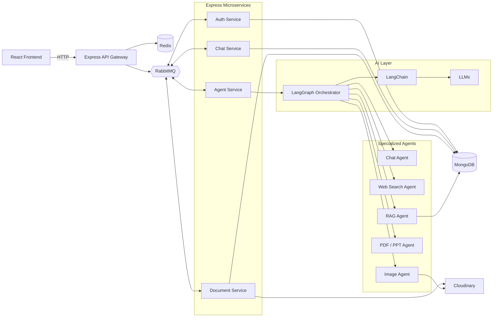

<div align="center">


# Gothalo AI

**Many agents. One conversation.**

A multi-agent AI platform for chat, web search, image generation, document creation, and RAG, built with React, Express, and npm workspaces.

<br />


<br />


</div>

---

> [!TIP]
> 🚀 **Ready to Deploy.** Gothalo AI is feature-complete for its initial release. See [Deployment](#-deployment) to get it running.

## 📖 About

Gothalo AI is a multi-agent AI platform. Instead of a single chatbot, a coordinating agent routes each request to a specialized agent for chatting, searching the internet, generating images, producing documents, or answering from your own files with retrieval-augmented generation (RAG).

The backend is a set of Express services that communicate asynchronously through RabbitMQ. Agent workflows are built with LangChain and LangGraph on top of LLMs, all in a single npm workspaces repository.

## ✨ Features

| Feature | Description |
| --- | --- |
| 💬 **AI chat** | Conversational chat with an LLM |
| 🌐 **Internet search** | Agent that searches the web to ground answers in current information |
| 🎨 **Image generation** | Generate images from text prompts |
| 📄 **PDF generation** | Create PDF documents from prompts |
| 📊 **PPT generation** | Create slide presentations from prompts |
| 📚 **RAG** | Answer questions from your own uploaded documents |
| 🤝 **Multi-agent orchestration** | A LangGraph workflow that routes tasks to specialized agents |

## 🧰 Tech Stack

| Layer | Technologies |
| --- | --- |
| **Monorepo** | npm workspaces |
| **Frontend** | React, Tailwind CSS |
| **Backend** | Express, TypeScript |
| **Data** | MongoDB with Mongoose, Redis (sessions and caching) |
| **Messaging** | RabbitMQ |
| **AI** | LLMs, LangChain, LangGraph |
| **Media** | Cloudinary |
| **Infrastructure** | Docker, Docker Compose |

## 🏗️ Architecture



<!-- VERIFY: service names, agent names, and which components use Mongo/Redis/Cloudinary are inferred from the feature list. Add the vector store and search/image providers you actually use. -->

## 📁 Project Structure

```text
gothalo-ai/
├── apps/          # React frontend (and backend services, if kept here)
├── packages/      # Express services and shared packages
├── assets/        # Logo and static README assets
└── package.json   # npm workspaces root
```

<!-- VERIFY: replace with the actual workspace layout from the "workspaces" field in the root package.json. -->

## 🚀 Getting Started

### Prerequisites

- Node.js and npm
- Docker and Docker Compose

### Installation

```bash
git clone <your-repository-url>
cd gothalo-ai
npm install
```

### Configuration

<!-- VERIFY: document the real environment files and variables (e.g. from .env.example). None are listed here to avoid inaccuracies. -->

Create the required environment files for MongoDB, Redis, RabbitMQ, Cloudinary, your LLM provider, and any search or image-generation providers, as described in the repository's example env files. Never commit secrets.

### Run locally

```bash
# Start infrastructure (verify the Compose file path and service names)
docker compose up -d

# Run a script in a specific workspace (replace the placeholders)
npm run <script> --workspace=<workspace-name>
```

<!-- VERIFY: replace with the exact scripts defined in each workspace's package.json. -->

## 🚢 Deployment

1. Provision MongoDB, Redis, and RabbitMQ (managed services or containers).
2. Set production environment variables for every service, including Cloudinary and your LLM, search, and image-generation provider keys.
3. Build and start the stack:

```bash
npm run build
docker compose up -d --build
```

<!-- VERIFY: confirm the root build script, the production Compose file name (e.g. -f docker-compose.prod.yml), and the host/platform you deploy to. -->

## 🗺️ Roadmap

- [x] 💬 AI chat
- [x] 🤝 LangGraph multi-agent orchestration
- [x] 🌐 Internet search agent
- [x] 📚 RAG over uploaded documents
- [x] 🎨 Image generation
- [x] 📄 PDF and 📊 PPT generation
- [ ] 🧪 Expanded testing and CI/CD
- [ ] 📈 Monitoring and observability

<!-- VERIFY: adjust checkmarks and planned items to match reality. -->

## 📄 License

A license has not yet been specified for this project.

<!-- VERIFY: if a LICENSE file exists in the repository, replace this section with its name and a link. -->

---

<div align="center">

**Gothalo AI** · Many agents. One conversation.

</div>
